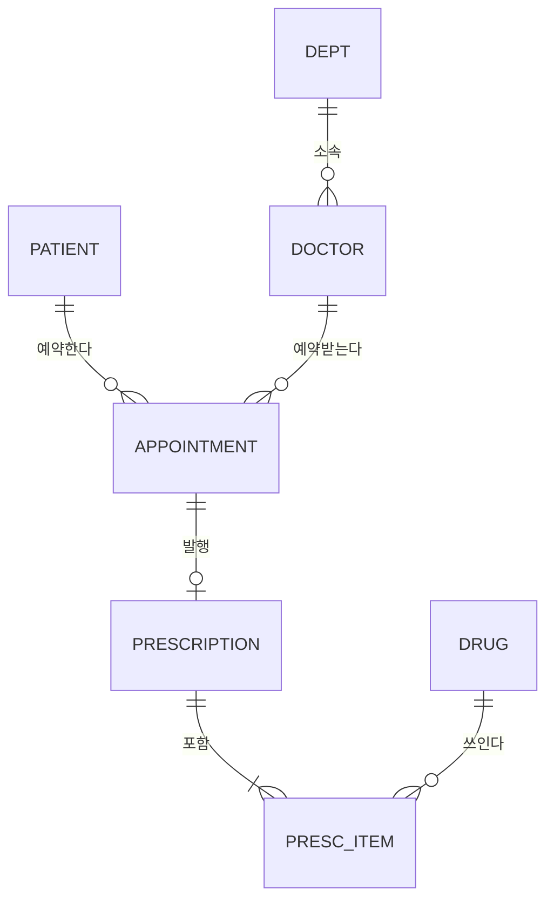

# ex01 정답 (H) — 병원 예약 모델
**G1 엔터티(식별자) / 속성**
* 환자(환자번호) / 이름, 생년월일, 연락처
* 진료과(진료과코드) / 진료과명
* 의사(의사번호) / 이름, 진료과코드(FK)
* 예약(예약번호 — 인조 식별자) / 환자번호(FK), 의사번호(FK), 예약일시, 상태
* 처방전(처방전번호 또는 예약번호) / 발행일, 예약번호(FK)
* 약품(약품코드) / 약품명
* 처방약품(처방전번호, 약품코드) / 용량 ← M:N 해소

**G2 관계 (IE)**

* 진료과 1 : 의사 N — 의사 쪽 필수, 진료과 쪽 선택
* 환자 1 : 예약 N, 의사 1 : 예약 N — 예약 쪽 필수 / 환자·의사 쪽 선택(예약이 없을 수 있음)
* 예약 1 : 처방전 0..1 — 처방전 쪽 필수, 예약 쪽 선택
* 처방전 M : 약품 N → 처방약품. "처방전에는 여러 약품"이므로 처방전 쪽에서 최소 1개(부모 쪽 필수)로 읽을 수 있다 → 선언적 제약으로 불가(G4)

**G3** 처방약품 PK = (처방전번호, 약품코드), 두 FK. 용량은 이 교차 엔터티의 속성이다.

**G4**
* 규칙 6 '같은 의사·같은 일시 중복 예약 금지' → 예약에 **UNIQUE(의사번호, 예약일시)**. 단, 취소된 예약은 제외해야 한다면 일반 UNIQUE로는 부족하다. SQL Server는 필터링된 UNIQUE 인덱스(WHERE 상태 <> '취소'), Oracle은 함수 기반 UNIQUE 인덱스(CASE WHEN 상태 <> '취소' THEN … END)로 구현한다(미실행·설계 검토).
* 선언적 제약으로 불가: '처방전에 약품 최소 1개'(부모 쪽 필수), '완료된 예약에만 처방전 발행'(다른 테이블의 상태 조건) → 트리거·응용 로직.
