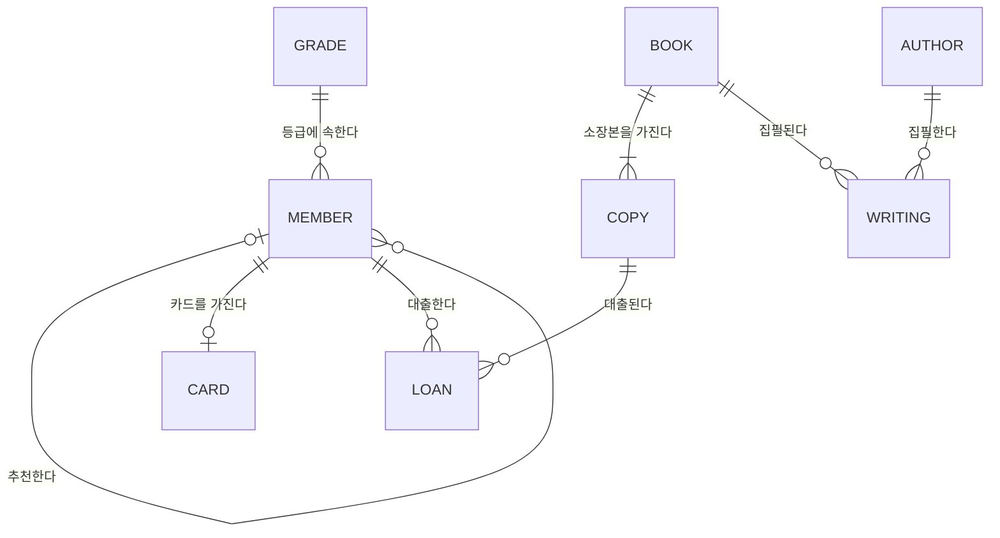
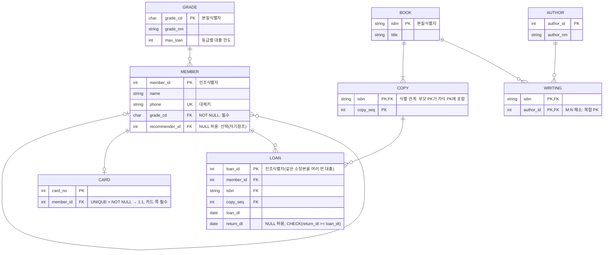

# ex01 업무 규칙 → 엔터티·속성·관계 → 개념적 ERD → 논리적 ERD

> 근거: 요구목록 §6(업무 규칙에서 엔터티·속성·관계 추출, IE·Barker 표기법). **추출본에 1과목 해당 본문 없음** · 데이터: 단원 안내의 업무 규칙 R1~R10(학습용 가상) · 처리 방식: **설계·도식 실습**. SQL 실행 대상이 아니다. 이 설계의 구현과 검증은 02단원 ex01에서 한다.

## A. 개념 설명
* **엔터티**: 업무에서 관리할 대상의 집합(회원, 도서). 인스턴스(행)가 두 개 이상이고, 식별할 수 있으며, 속성을 가진다.
* **속성**: 엔터티를 설명하는 더 이상 나눌 필요가 없는 값(이름, 대출일).
* **관계**: 엔터티 인스턴스 사이의 업무상 연결(회원이 소장본을 *대출한다*).
* **차수(cardinality)**: 관계에 참여하는 인스턴스 수(1:1, 1:N, M:N). **선택성(optionality)**: 반드시 참여해야 하는지(필수) 아닌지(선택).
* **개념적 ERD**: 엔터티와 관계 중심. 속성은 핵심만 적는다. DBMS와 무관하다. **논리적 ERD**: 모든 속성, 식별자(PK), 외래키, 정규화, M:N 해소까지 반영한다. **물리적 모델**: 자료형·인덱스·DBMS 문법(02단원).

## B. 입력: 업무 규칙에서 후보 뽑기
| 규칙 | 명사 → 엔터티/속성 후보 | 동사 → 관계 후보 | 판단 |
|---|---|---|---|
| R1 | 회원, 회원번호, 이름, 전화번호 | — | 회원 = 엔터티. 회원번호 = 식별자. 전화번호 = 대체키 후보(유일) |
| R2 | 등급 | 회원은 등급에 *속한다* | 등급 = 엔터티(코드성). 회원→등급 **필수** |
| R3 | 도서, ISBN, 소장본, 일련번호 | 도서는 소장본을 *가진다* | 소장본은 도서에 **종속** → 식별 관계 후보(ex03) |
| R4 | 대출 | 회원이 소장본을 *대출한다* | 회원:소장본 = M:N → **대출** 교차 엔터티로 해소 |
| R5 | 대출일, 반납일 | — | 대출의 속성. 반납일은 NULL 허용(선택 속성) |
| R6 | — | — | **행 하나로 판단할 수 없는 규칙** → 제약으로 구현 불가(ex06) |
| R7 | 저자 | 도서-저자 *집필* | M:N → 집필 교차 엔터티 |
| R8 | 추천인 | 회원이 회원을 *추천한다* | 순환(자기참조) 관계, 선택(ex05) |
| R9 | 회원카드 | 회원이 카드를 *가진다* | 1:1. 카드 쪽 필수, 회원 쪽 선택 |
| R10 | — | — | 등급 쪽은 선택(회원 0명 가능). 도서 쪽 "소장본 ≥ 1"은 **부모 쪽 필수** → 선언적 제약으로 구현 불가(ex02, ex06) |

## C. 개념적 ERD (IE / 정보공학 표기, 까마귀발)
엔터티와 관계, 차수·선택성만 표시한다. `||` = 정확히 1(필수), `o|` = 0 또는 1, `|{` = 1 이상, `o{` = 0 이상.



읽는 법(예): `BOOK ||--|{ COPY` = "도서 하나는 소장본을 **1개 이상** 가진다(R10). 소장본 하나는 **정확히 하나**의 도서에 속한다."

## D. 논리적 ERD (속성·식별자·외래키 포함, M:N 해소)


## E. Barker 표기법으로 같은 모델 읽기 (일부)
Mermaid는 Barker 표기를 지원하지 않는다. 그래서 규칙을 글과 문자 도식으로 정리한다.
* 엔터티는 모서리가 둥근 사각형이다. 속성 앞의 `#`는 식별자, `*`는 필수 속성, `o`는 선택 속성이다.
* 관계선의 **실선** 쪽은 필수 참여, **점선** 쪽은 선택 참여다. 까마귀발은 "많음(N)"이다. 관계 이름은 양쪽 엔터티 기준으로 각각 적는다.
* 식별 관계는 자식 쪽 관계선에 **가로 막대(UID bar)** 를 그어 표시한다.

```
 ┌──────────────┐  소속된다        소속시킨다  ┌───────────────┐
 │ 등급          │ ─────────────────────<·····│ 회원           │
 │ # 등급코드    │  (회원 쪽 실선 = 필수)       │ # 회원번호     │
 │ * 등급명      │  (등급 쪽 점선 = 선택,       │ * 이름         │
 └──────────────┘   회원 0명 가능)             │ o 전화번호     │
                                              └───────────────┘
 ┌──────────────┐  가진다               속한다 ┌───────────────┐
 │ 도서          │ ──────────────────────<─────│ 소장본         │
 │ # ISBN       │  (양쪽 실선 = 양쪽 필수)     ┼│ # 일련번호     │  ← ┼ : UID bar = 식별 관계
 │ * 제목        │                              │               │     (도서 ISBN이 소장본 식별자의 일부)
 └──────────────┘                              └───────────────┘
```
(IE와 Barker는 같은 사실을 다르게 그린다. IE는 선 끝 기호로 필수/선택을 나타내고, Barker는 선 종류(실선/점선)로 나타낸다.)

## F. 결과 예측·확인 문제
1. R4의 "대출"을 회원–소장본 사이의 관계선으로만 두면 어떤 정보를 둘 곳이 없어지는가? (대출일·반납일 → 교차 엔터티 필요)
2. LOAN의 PK를 (member_id, isbn, copy_seq)로 하면 어떤 업무를 표현할 수 없는가? (같은 회원이 같은 소장본을 두 번 빌리는 경우)
3. R9의 1:1을 CARD.member_id에 UNIQUE를 걸어 구현했다. "카드는 반드시 한 회원의 것"은 어떤 제약으로 표현하는가? (NOT NULL)

## G·H
* 직접 작성 문제: [../exercises/ex01_business_rules_to_erd.md](../exercises/ex01_business_rules_to_erd.md)
* 정답: [../answers/ex01_business_rules_to_erd_answer.md](../answers/ex01_business_rules_to_erd_answer.md)
* 이 ERD를 그대로 구현한 DDL과 "업무 규칙 ↔ 제약조건" 대응표: [02단원 ex01](../../02_erd_to_ddl/examples/ex01_library_ddl.md)
