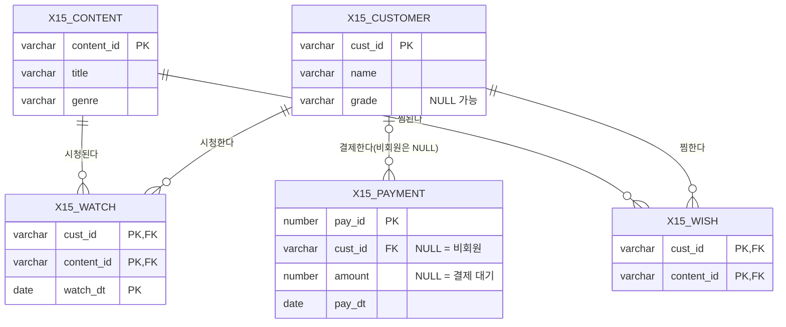

# 15 SQLD 복합 문제 — 단원 안내

ERD 하나와 업무 설명을 보고, 요구 결과를 내는 SQL을 보기 4개 중에서 고른다. 문제마다 **보기 4개를 실제로 실행**하고, 각 보기의 결과가 요구 결과와 같은지(MATCH/DIFF)를 DBMS가 판정한다.
정답 보기는 `lab_check`로 한 번 더 검증한다(CHECK_PASS). 해설은 정답만이 아니라 **오답이 어떤 결과를 내는지와 그 이유**를 설명한다.

<a id="erd"></a>
## 공통 ERD (학습용 가상 데이터: 동영상 스트리밍 서비스)

X15_CONTENT_NOPK는 PK 없이 이관된 콘텐츠 마스터다(T1이 두 번 들어 있음, Q1).

| 테이블 | 데이터 |
|---|---|
| X15_CUSTOMER | C1 가 VIP / C2 나 GOLD / C3 다 GOLD / C4 라 NULL |
| X15_CONTENT | T1 SQL 강의 EDU / T2 액션 영화 MOVIE / T3 바다 다큐 DOCU / T4 음악 쇼 SHOW |
| X15_WATCH | C1–T1 3/1, C1–T1 3/5, C1–T2 3/2, C2–T2 3/3, C3–T3 3/4 |
| X15_WISH | C1–T2, C1–T3, C2–T1, C2–T2, C4–T4 |
| X15_PAYMENT | 1 C1 10000 / 2 C1 10000 / 3 C2 NULL(대기) / 4 C3 5000 / 5 NULL(비회원) 3000 |

## 문제 목록
| 문제 | 주제(요구목록 §9) |
|---|---|
| [Q1](examples/q01_missing_pk_join.md) | PK·FK 누락으로 발생하는 JOIN 오류 |
| [Q2](examples/q02_one_to_many_double_count.md) | 1:N 관계에서 결과 행 수 증가 |
| [Q3](examples/q03_left_join_where.md) | LEFT JOIN과 WHERE 조건의 상호작용 |
| [Q4](examples/q04_on_vs_where_filter.md) | ON과 WHERE의 조건 배치 차이 |
| [Q5](examples/q05_exists_customer_vs_content.md) | EXISTS·NOT EXISTS, 고객ID만 비교 vs 고객ID+컨텐츠ID 비교 |
| [Q6](examples/q06_not_in_null.md) | NULL이 결과를 바꾸는 경우(NOT IN) |
| [Q7](examples/q07_group_by_vs_window.md) | GROUP BY와 윈도우 함수의 차이 |
| [Q8](examples/q08_null_aggregate.md) | NULL이 결과를 바꾸는 경우(집계) |

## 다시 만들기
```bash
python3 tools/gen_exam.py && python3 tools/run_labs.py 15_integrated_exam
```
문제 내용은 `tools/answer_specs/exam15.py`에 있다. 변형 문제를 만들려면 이 명세의 데이터나 요구 결과를 바꾸고 다시 생성한다. 정답이 바뀌면 MATCH 위치가 달라지는 것으로 확인할 수 있다.
